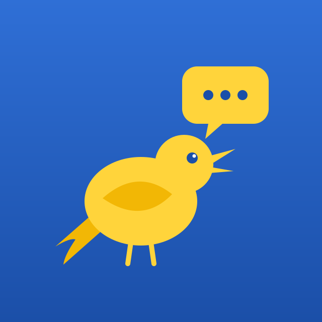
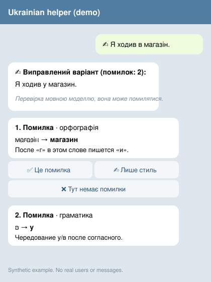

# Солов'їна

**Спробувати: [@solovyinamova_bot](https://t.me/solovyinamova_bot)**

Telegram-бот: помічник з української для російськомовних.

[English](README.md) · **Українська**

Telegram-помічник для російськомовних, які переходять на українську й хочуть
писати природніше, розуміти свої помилки та запам'ятовувати виправлення.

Це навчальний інструмент. Він **не замінює** професійного перекладача чи
викладача, а перевірка мовною моделлю може помилятися.



*Зображення — макет із вигаданим текстом, не реальне листування.*

## Сценарій

1. `/start` показує кнопки режимів на клавіатурі.
2. **💬 Як сказати?** — російська чи змішана фраза перетворюється на природний
   український варіант із кнопкою 🔊.
3. **✍️ Перевір мене** — виправлений текст і до трьох пояснень. Під кожним
   виправленням кнопки `✅ Це помилка` · `❌ Тут немає помилки` · `✍️ Лише стиль`.
4. **🗂 Мої помилки** — виправлення, які ви підтвердили.
5. **🃏 Повторити** — картки (питання, відповідь, «Знову / Важко / Добре / Легко»)
   з цих помилок і зі слів, які ви попросили запам'ятати.
6. **🎯 Тренування** (`/practice`) — до п'яти таких карток, відповідь треба
   написати. Збіг відкладає картку; інша відповідь показує правильний варіант
   і лишає картку на потім. `/progress` — підсумок за 7 днів.
7. Будь-яке інше повідомлення бот перекладає (укр ⇄ рос) і вказує фактичне
   джерело відповіді.

## Порядок джерел

**Основний шлях:** Claude сам визначає, російською чи українською написано, і
перекладає в інший бік. Бот нічого не перепитує.

**Окреме слово зі словника:** локальний словник і Wiktionary (миттєво, кілька значень).

**«Поясни слово» (`/explain`):** словникове визначення слова або короткого вислову
українською, частина мови, наголос, приклад і синоніми — не переклад російською.
Потребує Claude і може помилятися.

**Запасний шлях** (немає ключа Claude або вичерпано ліміт): Google Translate
(офіційний API, якщо задано ключ) → MyMemory. Відповідь мовою, що не збігається
з цільовою, відкидається.

**/check:** пояснення помилок лише українською.

Мова визначається лише як підказка. Якщо бот не впевнений, він питає; напрям
можна закріпити командою `/direction`.

## Запуск

```bash
python -m venv .venv && source .venv/bin/activate
pip install -r requirements-dev.txt
cp .env.example .env     # вставте власний токен
PYTHONPATH=src python -m bot
```

Обов'язкова змінна — лише `TELEGRAM_BOT_TOKEN`. Без `ANTHROPIC_API_KEY` бот
працює: словник, Wiktionary і MyMemory доступні, функції моделі вимкнені.
Повний перелік змінних — у [README.md](README.md#environment-variables).
Розгортання — [DEPLOY_GUIDE.md](DEPLOY_GUIDE.md).

## Приватність

* Обробляється: текст повідомлення та числовий Telegram ID.
* Передається: Wiktionary, MyMemory, Anthropic (якщо увімкнено), Google TTS
  (лише після натискання 🔊).
* Зберігається: напрям перекладу; для перевірки — лише виправлені фрагменти,
  пояснення, назва моделі, версія шаблону та ваша оцінка; картки повторення
  (слово або фрагмент, відповідь, дата повторення); журнал дій
  (функція, джерело, час, оцінка) під псевдонімом, без Telegram ID і текстів.
* Не зберігається: ім'я, username, історія повідомлень, повний текст.
* `/delete_my_data` — видалити все; старі записи видаляються автоматично.

## Обмеження

* Автовизначення мови евристичне.
* Якість перевірки ще **не виміряна** — для цього й потрібні кнопки оцінки.
* MyMemory має денний ліміт; gTTS використовує неофіційний сервіс Google.
* Озвучка — це синтез мовлення, а не оцінка вимови.

## Джерела даних і ліцензії

Проєкт поширюється під **GPL-2.0-or-later** ([LICENSE](LICENSE)), бо словник
побудовано на даних Apertium (GPL-2.0).

* Apertium rus-ukr — https://github.com/apertium/apertium-rus-ukr, GPL-2.0.
* Wiktionary — CC BY-SA 4.0, із зазначенням джерела в кожній відповіді.
* Ручні словникові статті — походження ще уточнюється ([data/README.md](data/README.md)).

Докладно: [THIRD_PARTY_NOTICES.md](THIRD_PARTY_NOTICES.md).

## Плани

1. Вимірювання якості перевірки за оцінками користувачів.
2. Словоформи в «Поясни слово».
